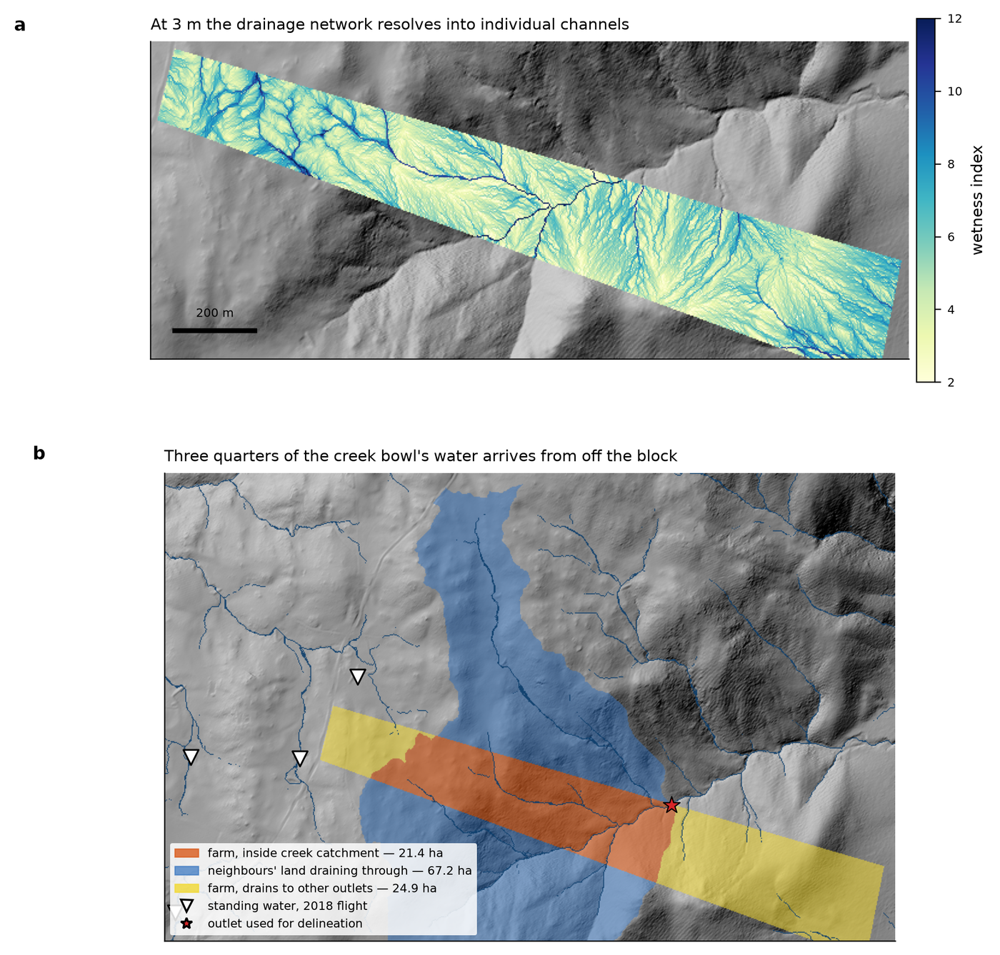
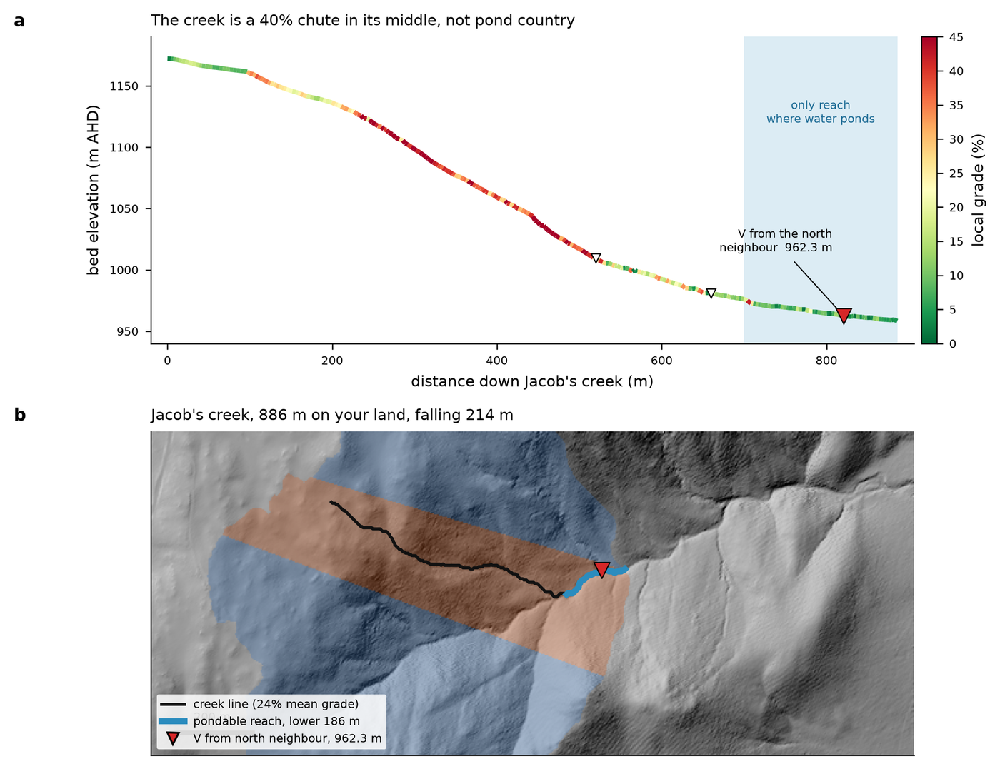

# pychannelform

**Where the water goes after it lands.**

Rain does not stay where it falls, and a fence does not divert it. If you want to
know which part of a block will dry out first, where erosion starts, where a
revegetation planting will actually get water, or how much of the flow through your
gully is someone else's rain, you need the drainage structure rather than the
elevation map.

This package takes a flow grid derived from a bare-earth surface and returns the
things a land manager and an ecologist both ask for: the catchment above any point,
the channel network at a chosen threshold, the longest flow path through a property,
and the long profile and reach grades along it.

The useful consequence, found repeatedly, is that **a property boundary and a water
system almost never coincide.** Planning drainage, dams or riparian plantings inside
the fence line alone means planning for a fraction of the water involved.

## Where this sits

Six small packages, one chain. Each does one thing and each is useful on its own.

| package | reads | gives you |
|---|---|---|
| [pylidarterrain](https://github.com/jborevitz/pylidarterrain) | classified airborne LiDAR | the ground surface a plant actually stands on: slope, aspect, how much sky it can see |
| [pyterrainsol](https://github.com/jborevitz/pyterrainsol) | that surface + daily weather | light and evaporative demand, cell by cell, day by day |
| [pyterrainwind](https://github.com/jborevitz/pyterrainwind) | that surface + reanalysis wind | wind exposure, and the extra demand it carries |
| **pychannelform** (this one) | that surface | **where the water goes: catchments, channels, long profiles** |
| [pylandstore](https://github.com/jborevitz/pylandstore) | channels + demand | where to hold water, and what it costs to move it uphill |
| [pylandgraze](https://github.com/jborevitz/pylandgraze) | all of the above + a herd | where the animals should be, hour by hour and season by season |

## Quickstart

```python
from pychannelform import (delineate, extract_channels, longest_path,
                           long_profile, reach_grades)

catchment = delineate(flow_dirs, outlet_row, outlet_col)
channels  = extract_channels(flow_acc, cell_area_m2=9.0, min_area_ha=0.5)
path, length = longest_path(flow_dirs, channels, res=3.0, within=farm_mask)
dist, z = long_profile(dem, path, res=3.0)
grades = reach_grades(dist, z, bin_m=100.0)
```

The flow grid comes from [`pylidarterrain`](https://github.com/jborevitz/pylidarterrain).

## What it found at 845 Avonside



*At 3 m the drainage network resolves into individual channels rather than a smear.
The creek bowl is 88.7 ha, of which only **21.4 ha (orange) lies inside the
property** — 67.2 ha (blue) drains through from neighbouring land, and a further
24.9 ha of the farm drains to other outlets entirely. **The block straddles a divide;
it is not one water system.***

Three quarters of the water moving through the main gully is the neighbours' rain.
That sets what is and is not controllable: in-channel structures intercept a
catchment that is mostly external, while anything aimed at the farm's own runoff has
only 21.4 ha to work with. It also means a wet year upstream arrives here regardless
of how the block itself is managed.



*The main channel: 886 m on this property, falling 213.9 m at a **24.1% mean grade**,
with a 38–42% chute through its middle. Tributary junctions are marked with the
direction each arrives from — only the lowest one, at 962.3 m, actually captures the
northern neighbour's catchment.*

A quarter grade in a channel is energy. Water arrives fast, so erosion control and
any planting in that line has to survive flow rather than merely tolerate wet feet,
and the chute through the middle is where the gradient — and the risk — concentrates.
Where that water can usefully be held, and what it costs to get it back uphill, is
[`pylandstore`](https://github.com/jborevitz/pylandstore).

## Methods

The conventions this package enforces, the traps it exists to prevent, and what it
deliberately does not do are in **[`docs/methods.md`](docs/methods.md)**.

Methods and results are kept apart on purpose. The methods travel to any site and
will be re-checked against new ground and simulated data; the findings above are one
46 ha property in the Snowy Monaro, some of them specific to it and some likely to
generalise. Either can then be argued with without disturbing the other.
