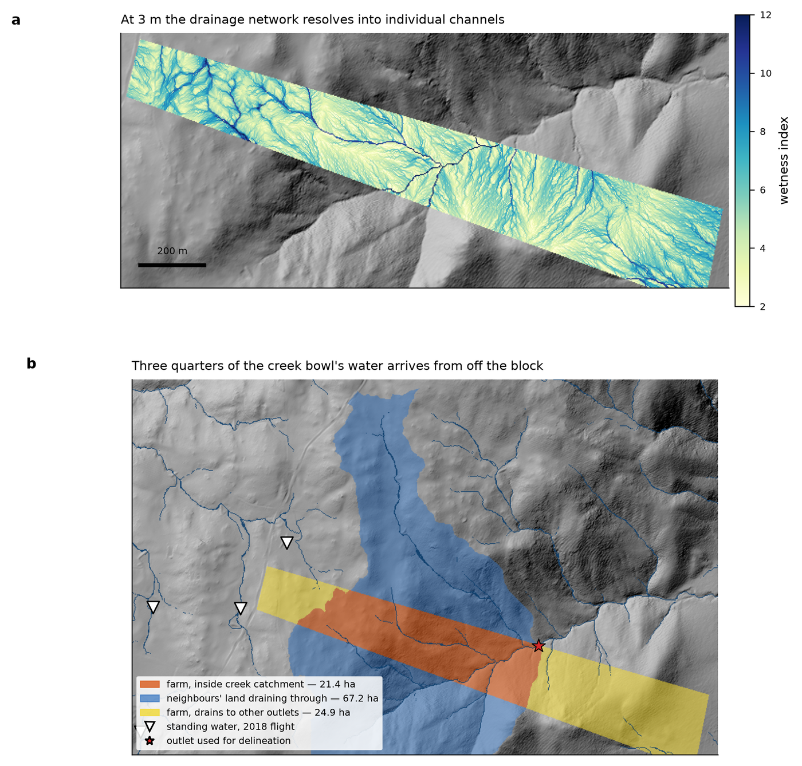
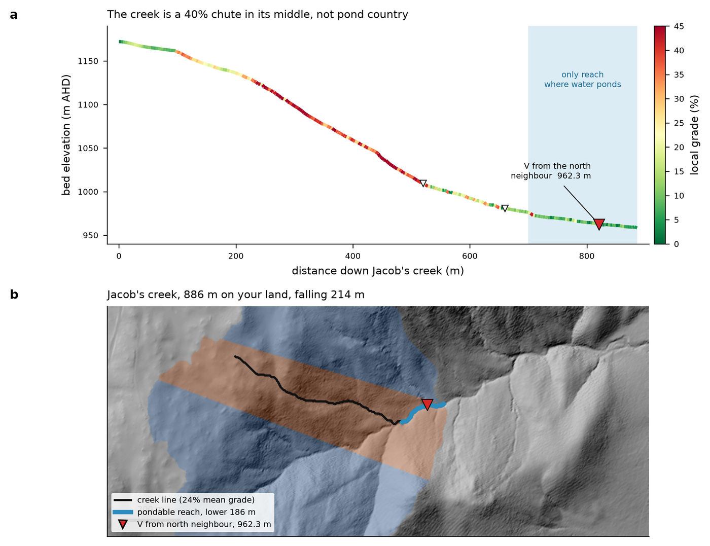

# pychannelform

Catchments, channel networks and longitudinal profiles from a D8 flow grid.

```python
from pychannelform import delineate, extract_channels, longest_path, long_profile, reach_grades

catchment = delineate(flow_dirs, outlet_row, outlet_col)
channels  = extract_channels(flow_acc, cell_area_m2=9.0, min_area_ha=0.5)
path, length = longest_path(flow_dirs, channels, res=3.0, within=farm_mask)
dist, z = long_profile(dem, path, res=3.0)
grades = reach_grades(dist, z, bin_m=100.0)
```

## Trace downstream, not upstream

Each cell has exactly one receiver, so downstream tracing is unambiguous. Walking
upstream forks at every junction and a "follow the biggest donor" rule terminates
early in flat or filled reaches. `longest_path` starts from channel heads and traces
down.

## Clip late

A property boundary is a legal object, not a hydrological one. Delineate on a buffered
grid and clip only when reporting: at Avonside, 76% of the creek bowl's 88.7 ha
catchment lies outside the title, and routing on the boundary alone starves exactly
the hollows you are looking for.

## Grade, not degrees

`reach_grades` returns a fraction; multiply by 100 for percent. 100% is 45°, and the
two units are confused constantly — label both on every figure.

## Worked example — a creek bowl that is mostly someone else's



*At 3 m the drainage network resolves into individual channels. The delineated creek
bowl is 88.7 ha, of which only 21.4 ha (orange) lies inside the property — 67.2 ha
(blue) drains through from neighbouring land, and a further 24.9 ha of the farm drains
to other outlets entirely. The block straddles a divide; it is not one water system.*



*The main channel: 886 m on this property, falling 213.9 m at a 24.1% mean grade, with
a 38–42% chute through its middle. Tributary junctions are marked with the direction
each arrives from — only the lowest one, at 962.3 m, actually captures the northern
neighbour's catchment.*
